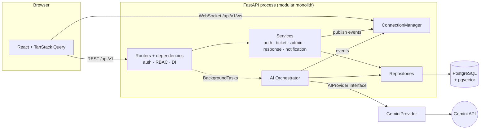
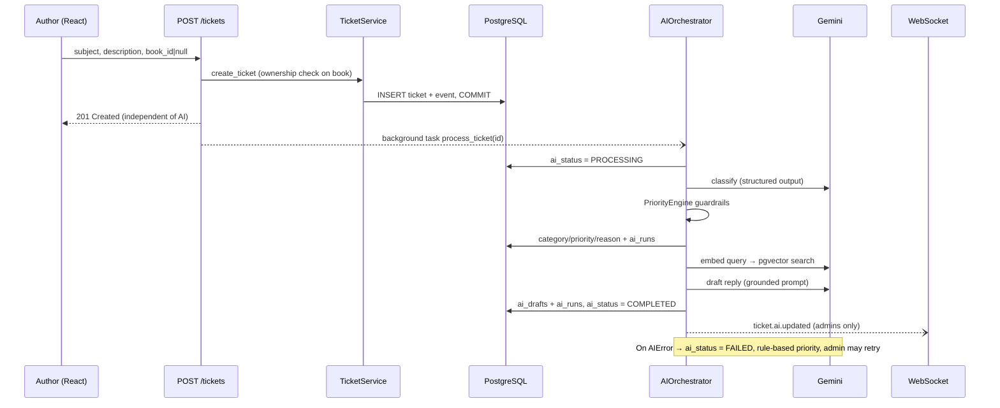
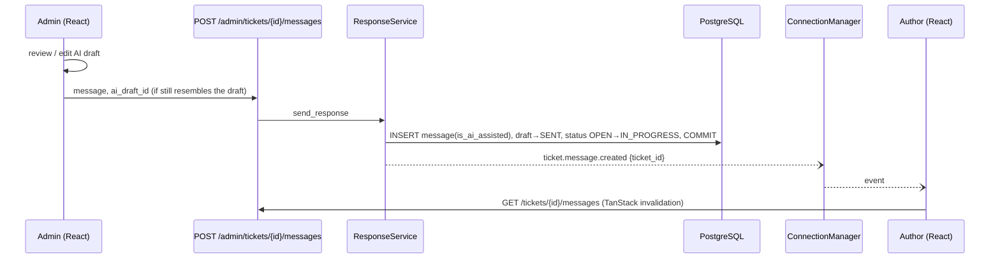
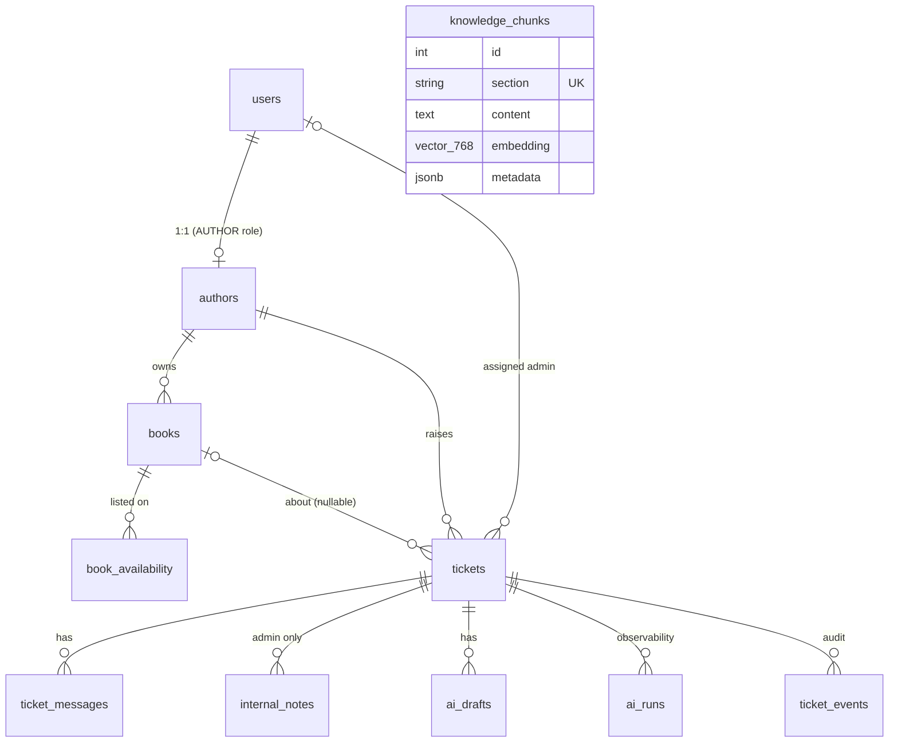

# Architecture

## 1. System context

Layering rule: **router → service → repository → database**. Routers do HTTP only; services own business rules, authorization and event publishing; repositories own every SQL statement; the AI package depends on repositories and an `AIProvider` interface but never on FastAPI.

## 2. Why a modular monolith

| Concern | Decision |
|---|---|
| Deployment | One container, one database: trivial to run, demo and reason about. |
| Consistency | Ticket creation, audit events and notifications share one transaction boundary (commit, *then* emit). |
| Team/scale | One team, modest traffic. The expensive resource is Gemini latency, which is already off the request path. |
| Evolution | Module boundaries are enforced by imports (`ai/` has no FastAPI imports; services take a session and a notifier). Extracting the AI package into a worker means swapping `BackgroundTasks` for a queue consumer calling the same `AIOrchestrator.process_ticket`. |

Microservices would add network failure modes, distributed tracing and deployment pipelines without solving any problem this system has.

## 3. Ticket creation flow

## 4. Admin reply flow (human in the loop)

## 5. Data model

Design notes: enums are stored as `VARCHAR` + CHECK (portable, no `ALTER TYPE` migrations); ids exposed to clients are the business ids (`AUTH001`, `BK001`, `TKT-1001`); money is `NUMERIC`; nullable columns mirror real nullability in the dataset (publication date, MRP, per-copy royalty, last payout, print partner); indexes on every FK, on `tickets(status, priority)` and `tickets(author_id, created_at)`.

## 6. Security architecture

* **Authentication**: JWT (HS256, 60 min) from `/auth/login`; Argon2id hashes; unknown-email logins verify against a dummy hash so timing doesn't reveal accounts; failed logins rate-limited per IP+email (429).
* **Authorization is server-side**: `require_admin`, `require_author` dependencies; author services filter by `author_id`; other authors' tickets/books return **404** (no existence leak). Internal notes are only reachable through admin routes and are never part of any author-facing schema (`MessageOut` / `TicketOut` have no such field; covered by tests).
* **Errors**: one schema (`error.code/message/details`), generic 500s, stack traces only in server logs.
* **Secrets**: `pydantic-settings` only; the Gemini key never reaches the browser; log filter redacts key patterns.
* **WebSocket**: token validated at connect (stateless), events carry ids only, so a socket cannot leak ticket content.

## 7. Frontend structure

TanStack Query owns server state (keys: `books`, `tickets`, `ticket/:id`, `messages/:id`, `admin-tickets`, `admin-ticket/:id`, dashboards). A focused `AuthContext` holds only the user + token lifecycle; an Axios interceptor adds the bearer token and funnels any 401 to logout. `ProtectedLayout` guards routes by role (UX only; the API enforces it). The admin ticket page is composed from `AuthorBookPanel`, `Conversation`, `AIInsightsPanel`, `DraftEditor`, `TicketControls`, `InternalNotes`.

## 8. Failure modes

| Failure | Behaviour |
|---|---|
| Gemini down / 429 / timeout | Retries with backoff; then `ai_status=FAILED`, rule-based priority, banner + retry button; ticket and replies unaffected |
| No API key | Same as above; seed skips embeddings; `/health` reports `ai_configured:false` |
| Embedding call fails | Retrieval falls back to category matching |
| Model returns off-schema output | Permanent error, not retried, logged in `ai_runs` |
| Hallucinated amount/ISBN in draft | Draft saved with `grounding_warnings`; UI shows "Verify before sending" |
| Admin override during AI run | Source flags re-read before write; `MANUAL` is never overwritten |
| Process restarts mid-AI | Ticket may stay `PROCESSING`; retry allowed after 3 min |
| WebSocket drops | Client reconnects with backoff; polling fallback every 30 s |
